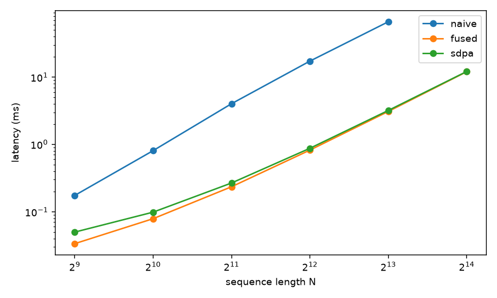
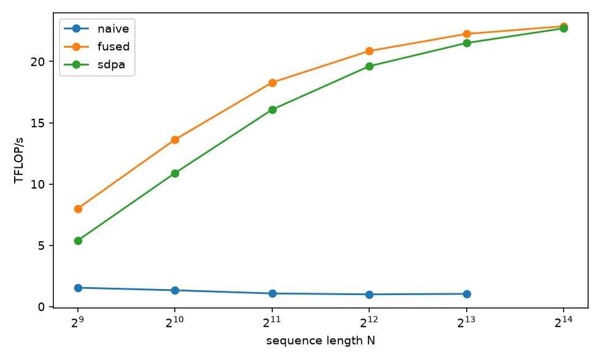
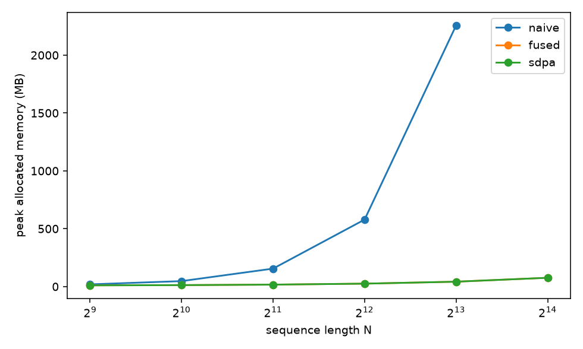

# Fused Attention Kernel

Triton implementation of FlashAttention-2 forward: `softmax(Q Kᵀ / √d) V` without writing the N × N score matrix to GPU memory.

## Why

Naive attention materializes `S = QKᵀ` and `P = softmax(S)`, both N × N, in HBM. Softmax over that matrix is memory-bound. At `B=1, H=32, N=32768, FP16`, `S` alone is 64 GiB.

This kernel tiles Q into SRAM, streams K/V past it, and combines partial softmax results with the online-softmax recurrence. Extra memory is O(N). The result is exact up to floating-point rounding.

## Algorithm

For each query tile `Q_i` (one Triton program):

```
m = -∞,  ℓ = 0,  acc = 0
for each key/value tile j:
    s     = Q_i K_jᵀ · scale
    m_new = max(m, rowmax(s))
    α     = exp(m − m_new)
    p     = exp(s − m_new)
    ℓ     = α · ℓ + rowsum(p)
    acc   = α · acc + p V_j
    m     = m_new
O_i = acc / ℓ
```

Causal attention stops the K/V loop at the diagonal tile and masks the upper triangle of that tile.

`exp2` is used instead of `exp`: the scale is multiplied by `log₂ e` so `exp(x) = 2^{x log₂ e}`. Accumulators stay FP32.

## Setup

```bash
python -m venv .venv
source .venv/bin/activate
pip install -r requirements.txt
```

Needs a CUDA GPU. Head dim must be one of 16, 32, 64, 128.

## Usage

```python
import torch
from src.attention import fused_attention, naive_attention

q, k, v = (torch.randn(1, 8, 1024, 64, device="cuda", dtype=torch.float16) for _ in range(3))
out = fused_attention(q, k, v, causal=True)
```

`fused_attention(..., autotune=True)` sweeps `BLOCK_M`, `BLOCK_N` ∈ {32, 64, 128}, `num_warps` ∈ {4, 8}, and `num_stages` ∈ {2, 3, 4}. On this GPU at `N=2048, D=64`, the winner was `BLOCK_M=64, BLOCK_N=32, 4 warps, 3 stages` — within noise of the default `64×64 / 4 warps / 2 stages`.

## Tests

```bash
pytest tests/ -q
```

Compares the kernel to `torch.nn.functional.scaled_dot_product_attention` across sequence lengths (including non-multiples of the tile), head dims, FP16/BF16, causal/non-causal, and non-contiguous inputs. CPU tests check naive attention and the NumPy online-softmax reference.

```bash
python notes/online_softmax.py
```

## Benchmarks

```bash
python benchmark/benchmark.py
python benchmark/benchmark.py --quick
python benchmark/benchmark.py --autotune
```

Writes `benchmark/results/results.csv` plus latency, TFLOP/s, and peak-memory plots. FLOP count is `4 N² d` per head (`2 N² d` if causal). The fused kernel does not reduce FLOPs; it reduces HBM traffic.

Hardware: NVIDIA GeForce RTX 4050 Laptop (6 GB), `B=1, H=8, D=64`, causal, FP16.

| N | naive (ms) | fused (ms) | SDPA (ms) | speedup vs naive | naive (MB) | fused (MB) |
|---|------------|------------|-----------|------------------|------------|------------|
| 512 | 0.175 | 0.033 | 0.051 | 5.3× | 19 | 11 |
| 1024 | 0.814 | 0.082 | 0.099 | 9.9× | 47 | 13 |
| 2048 | 4.02 | 0.235 | 0.266 | 17× | 155 | 17 |
| 4096 | 17.3 | 0.821 | 0.871 | 21× | 579 | 25 |
| 8192 | 66.4 | 3.08 | 3.19 | 22× | 2257 | 42 |
| 16384 | OOM | 12.0 | 12.1 | — | OOM | 76 |







Naive peak memory grows as O(N²) and runs out of memory at N=16384. The fused kernel stays linear and tracks SDPA (PyTorch's FlashAttention/cuDNN path).

## Layout

```
src/attention.py       Triton kernel + wrapper
src/naive.py           materialized PyTorch baseline
src/online_softmax.py  NumPy online-softmax reference
tests/test_attn.py
tests/test_online_softmax.py
benchmark/benchmark.py
notes/online_softmax.py
```

## References

- Dao et al., *FlashAttention*, NeurIPS 2022. [arXiv:2205.14135](https://arxiv.org/abs/2205.14135)
- Dao, *FlashAttention-2*, 2023. [arXiv:2307.08691](https://arxiv.org/abs/2307.08691)
- Milakov and Gimelshein, *Online normalizer calculation for softmax*, 2018. [arXiv:1805.02867](https://arxiv.org/abs/1805.02867)
- [Triton fused-attention tutorial](https://triton-lang.org/main/getting-started/tutorials/06-fused-attention.html)
